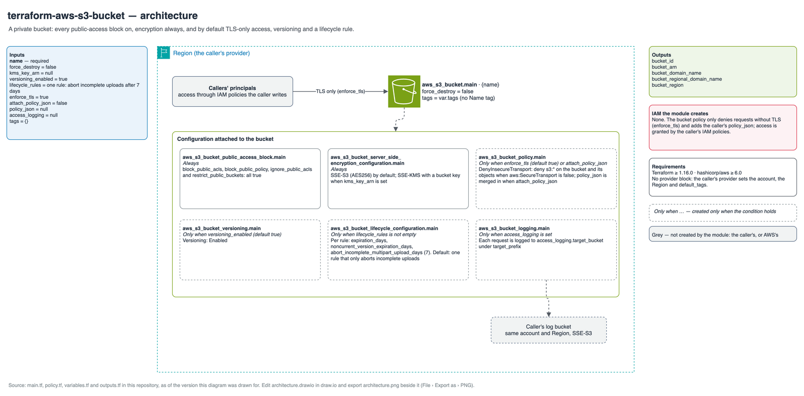

# Reference: resources, bucket policy and permissions

Every resource the module can create, when it is created, and what it is called.
`<name>` is `var.name`; `<bucket ARN>` is `arn:<partition>:s3:::<name>`.

## Diagram



Source: [`architecture.drawio`](architecture.drawio).

## Resources

| Resource | Created when | Name, tags and settings |
| --- | --- | --- |
| `aws_s3_bucket.main` | Always | Bucket `<name>`; tags exactly `var.tags`, with no `Name` tag added; `force_destroy = var.force_destroy` |
| `aws_s3_bucket_public_access_block.main` | Always | `block_public_acls`, `block_public_policy`, `ignore_public_acls` and `restrict_public_buckets` all `true` |
| `aws_s3_bucket_server_side_encryption_configuration.main` | Always | One rule. `kms_key_arn` null: `sse_algorithm = "AES256"` and nothing else. `kms_key_arn` set: `sse_algorithm = "aws:kms"`, `kms_master_key_id = kms_key_arn`, `bucket_key_enabled = true` |
| `aws_s3_bucket_versioning.main[0]` | `versioning_enabled` | Status `Enabled` |
| `aws_s3_bucket_lifecycle_configuration.main[0]` | `lifecycle_rules` is not empty | One rule per entry, in order; see [Lifecycle rules](#lifecycle-rules) |
| `aws_s3_bucket_policy.main[0]` | `enforce_tls` or `attach_policy_json` | See [Bucket policy](#bucket-policy) |
| `aws_s3_bucket_logging.main[0]` | `access_logging` is not null | `target_bucket` and `target_prefix` from `access_logging` |
| `data.aws_iam_policy_document.main[0]` | Same as the bucket policy | Renders the policy locally; makes no API call |

Only the bucket takes tags. Tags from the provider's `default_tags` are added to it
as usual. The module creates no `aws_s3_bucket_ownership_controls` and no ACL: new
buckets have the object ownership `BucketOwnerEnforced`, which disables ACLs.

Proof of the resource list: `grep -hE '^(resource|data) ' main.tf policy.tf`.

## Lifecycle rules

Each `lifecycle_rules` entry renders one `rule` block:

| Field | Renders | When |
| --- | --- | --- |
| `id` | `id` | Always |
| `enabled` | `status = "Enabled"`, or `"Disabled"` when `enabled = false` | Always |
| `prefix` | `filter { prefix = <prefix> }` | `prefix` set. Otherwise an empty `filter {}`, which matches every object |
| `expiration_days` | `expiration { days = <n> }` | Set |
| `noncurrent_version_expiration_days` | `noncurrent_version_expiration { noncurrent_days = <n> }` | Set |
| `abort_incomplete_multipart_upload_days` | `abort_incomplete_multipart_upload { days_after_initiation = <n> }` | Always; default 7, also when set to null |

The default, `[{ id = "abort-incomplete-multipart-uploads" }]`, renders one enabled
rule with an empty filter that aborts incomplete multipart uploads after 7 days.

## Bucket policy

The policy holds the statements of `policy_json`, in their order, followed by the
module's statement. The module writes exactly one statement, when `enforce_tls` is
true (the default):

```json
{
  "Sid": "DenyInsecureTransport",
  "Effect": "Deny",
  "Principal": "*",
  "Action": "s3:*",
  "Resource": ["<bucket ARN>", "<bucket ARN>/*"],
  "Condition": { "Bool": { "aws:SecureTransport": "false" } }
}
```

A `policy_json` statement with the `Sid` `DenyInsecureTransport` is replaced by this
one. The policy is applied only after the public access block.

## IAM granted by the module

None. The module creates no IAM role, user or policy, and writes no `Allow`
statement: every grant in the bucket policy comes from `policy_json`.

## Permissions the caller needs

To apply and destroy the module, the caller's credentials need:

- `s3:CreateBucket`, `s3:DeleteBucket` and `s3:ListBucket`.
- `s3:GetBucket*` and `s3:Get*Configuration`: the provider reads most of a bucket's
  settings when it refreshes `aws_s3_bucket`.
- `s3:PutBucketTagging`, `s3:PutBucketPublicAccessBlock`,
  `s3:PutEncryptionConfiguration`, `s3:PutBucketVersioning`,
  `s3:PutLifecycleConfiguration`, `s3:PutBucketPolicy`, `s3:DeleteBucketPolicy` and
  `s3:PutBucketLogging`.
- `s3:TagResource`, `s3:UntagResource` and `s3:ListTagsForResource`, which provider
  6.23 and later use for bucket tags when allowed, falling back to the bucket tagging
  calls.
- With `force_destroy = true`: `s3:ListBucketVersions`, `s3:DeleteObject` and
  `s3:DeleteObjectVersion`, to empty the bucket.

## Requirements

| | Minimum | Why |
| --- | --- | --- |
| Terraform | 1.16.0 | The floor shared by this family of modules |
| `hashicorp/aws` | 6.0 | The `bucket_region` attribute, read by the `bucket_region` output |

Provider versions 6.22 to 6.39 can plan an in-place change to the encryption
configuration on every run, for buckets created after S3 began blocking SSE-C on new
buckets by default; the provider changelog records the fix in 6.40. Use 6.40 or later
for new buckets.

Inputs and outputs are listed in the [README](../../README.md#inputs).
